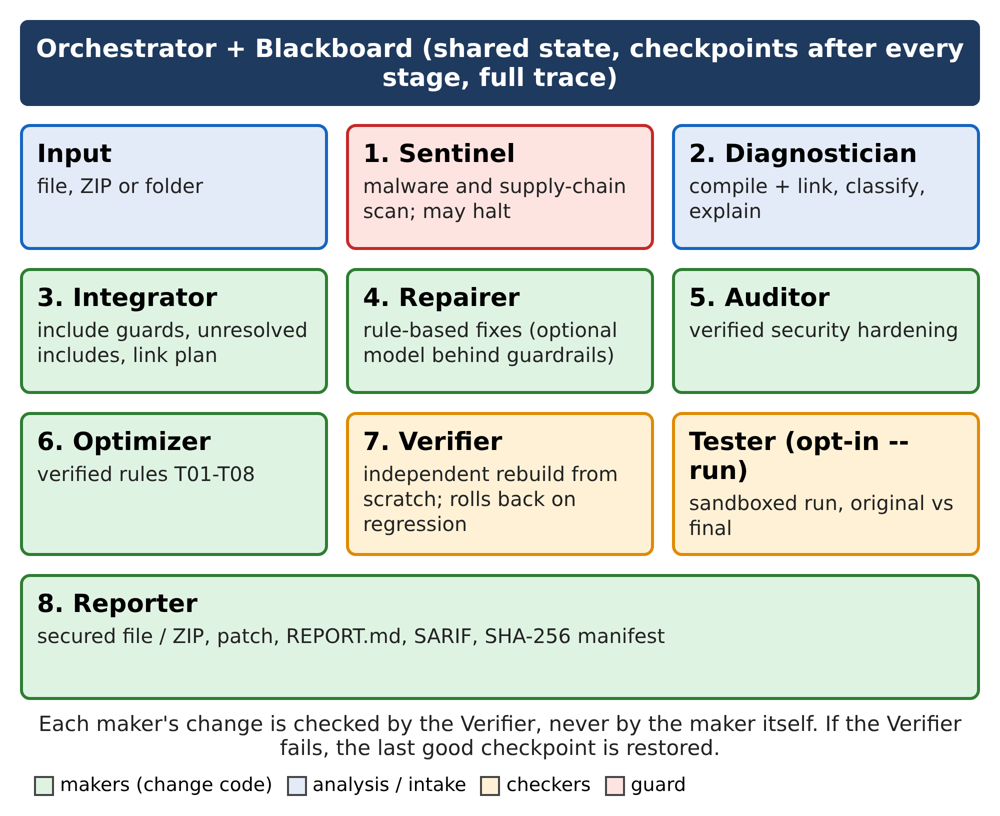
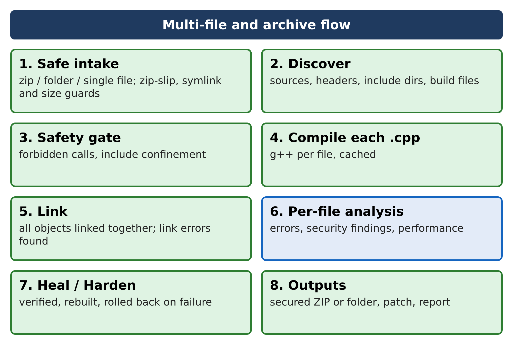
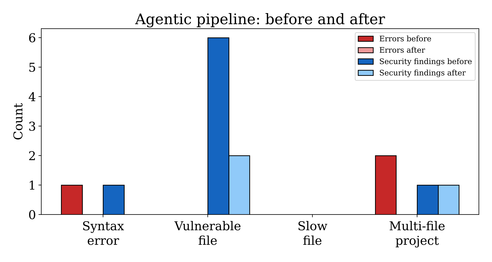
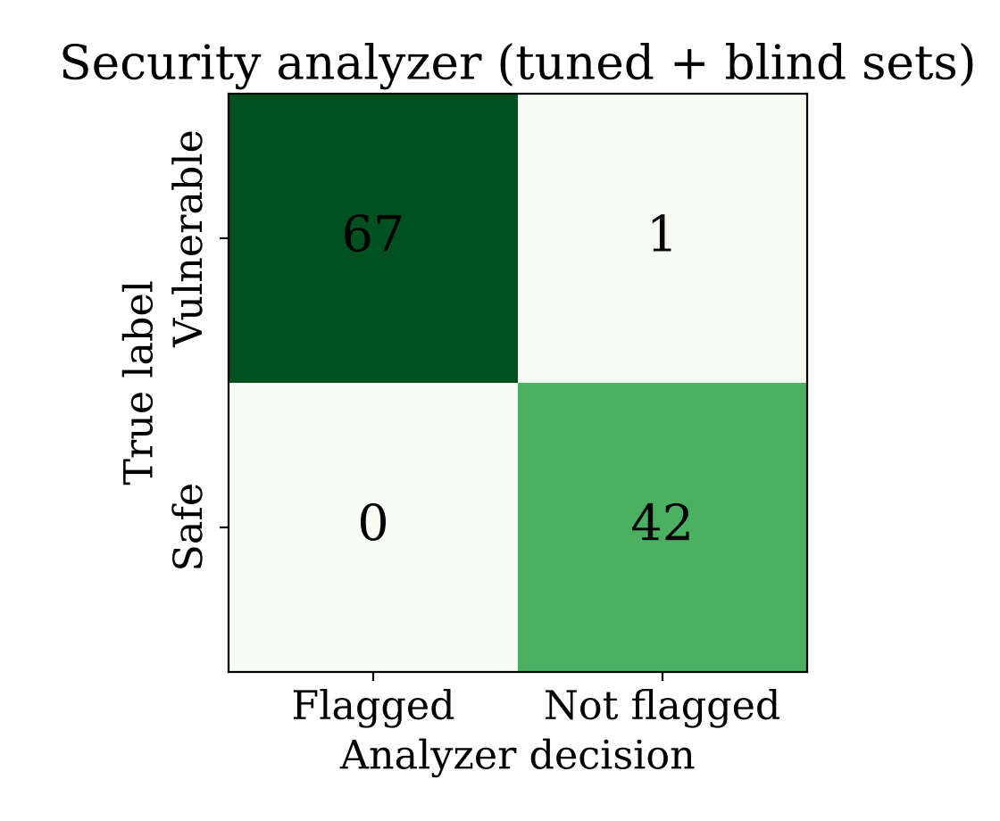
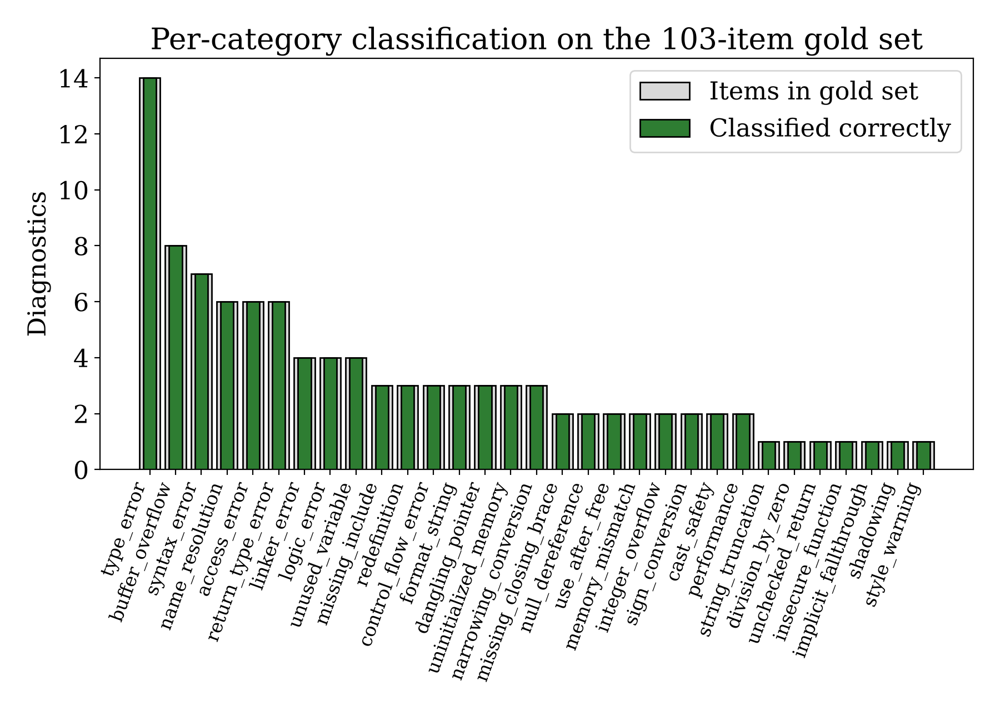
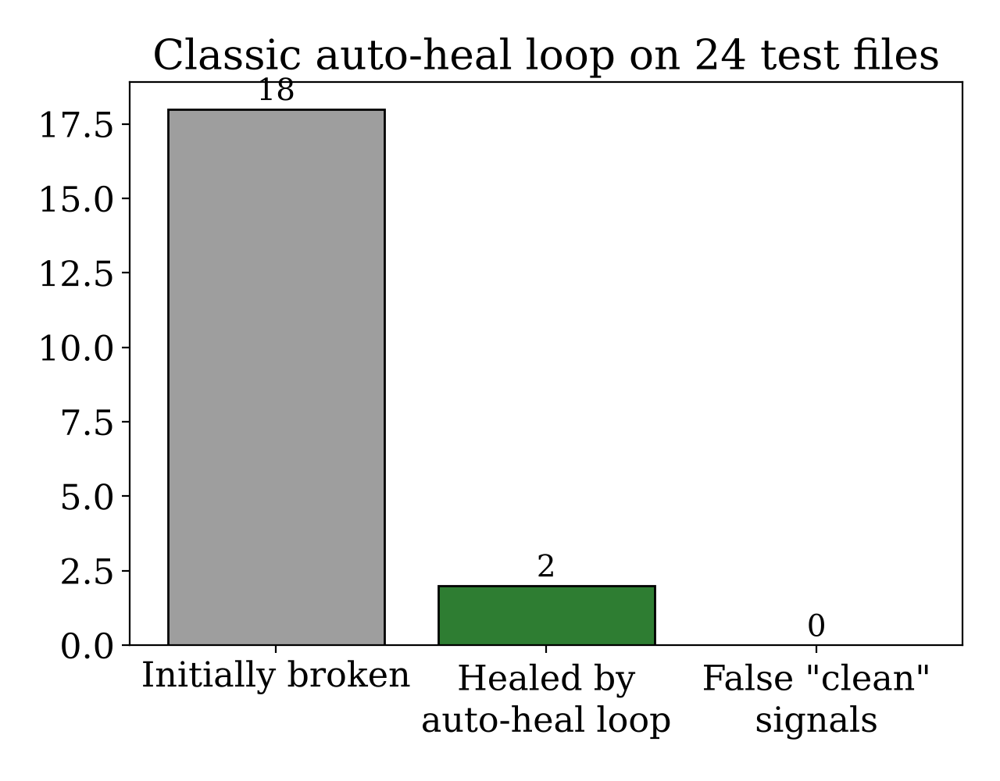

# Green Self-Healing Compiler

An intelligent C++ diagnostic and auto-repair pipeline layered on top of `g++`.
It compiles your code, **explains** errors in plain English, **classifies** them (rules + a small ML model),
runs a **security analysis** (CWE-labelled findings), and **repairs** code automatically, keeping a fix only
if the compiler confirms it. No LLM, no API keys, no network access at run time.

> Project-Based Lab, Compiler Design, NIT Warangal. See `PBL_Report.md` for the full report and
> `project_explanation.md` for how each part maps to a compiler-design concept.

## Features
- Plain-English explanations (what happened / why / how to fix) for g++ errors and warnings
- Error classification: rules first, ML fallback that abstains when unsure
- Security findings with CWE ids, severity and confidence (use-after-free, format string, buffer overflow, ...)
- Self-healing loop: compile -> classify -> apply one rule-based fix -> recompile (max 10 attempts)
- `--harden`: security fixes that are verified (still compiles AND the finding disappears)
- Performance advice (exponential recursion, hidden O(n^2), pass-by-value, ...)
- Build cache, safety gate (blocks `system()` etc. before any compiler runs), SARIF output and CI exit codes
- **Whole projects:** give it a folder, `.zip` or `.tar.gz` of C++ files and it compiles every file, **links them together**, and analyses / heals / hardens all of them (see below)
- PyQt6 GUI (editor, AST explorer, call graph, energy/carbon dashboard via CodeCarbon)

## Requirements
Linux (or WSL / Google Colab) with `g++` and `binutils`, and Python 3.10+.

```bash
sudo apt install g++ binutils python3 python3-pip
pip install -r requirements.txt
```

## Quick start
```bash
python3 src/main.py demo/01_null_deref.cpp           # explain + classify + security
python3 src/main.py demo/02_vulnerable.cpp           # CWE-labelled findings
python3 src/main.py demo/02_vulnerable.cpp --harden  # verified fixes -> 02_vulnerable.hardened.cpp
python3 tools/heal_demo.py demo/06_heal_semicolons.cpp   # watch the healing loop
python3 src/main.py file.cpp --fail-on high --format sarif   # CI usage (exit code 2 = fail)
```
Full guided demo: open `Final_Demo.ipynb` in Google Colab. Presenter notes: `PRESENTATION_GUIDE.md`.

## Whole projects: many files, one zip
Pass a folder, a `.zip` or a `.tar.gz` instead of a single file. Every `.cpp` is compiled (in parallel, with the
project's include folders), then the objects are **linked**, so cross-file mistakes show up too.

```bash
python3 src/main.py my_project.zip                  # compile + link + security + advice for ALL files
python3 src/main.py my_project/ --format sarif      # one SARIF report covering every file
python3 src/main.py my_project.zip --heal           # fix compile errors across files -> my_project.healed.zip
python3 src/main.py my_project.zip --harden         # verified security fixes in every file -> my_project.hardened.zip
python3 src/main.py my_project/ --harden --in-place # folders only: write fixes back into the folder
python3 src/main.py my_project/ --exclude 'tests/*' --exclude legacy --link-flags "-lm" --cxxflags "-DDEBUG"
```
Options: `--exclude GLOB` (repeatable), `--cxxflags`, `--link-flags`, `--jobs N`, `--out PATH`, `--max-attempts N`.

How it behaves
- **Link step:** one `main()` -> one program. Several `main()`s -> one program per `main()` (each together with all
  files that have none). No `main()` -> linked with a stub `main()` so missing or duplicate definitions are still found.
  Linker errors (`undefined reference`, `multiple definition`) are reported with the file and line.
- **Safety:** an upload is untrusted. Zip-slip / absolute paths / symlinks are rejected or skipped, size and file-count
  limits stop zip bombs, and the safety gate scans **every** source and header *before any compiler runs* (one blocked
  file blocks the whole project, because linking would pull it in). Nothing is ever executed.
- **Never edits your upload.** Work happens on a private copy; fixes are written to a new `.healed` / `.hardened`
  zip or folder (`--in-place` is allowed for folders only and keeps CRLF line endings).
- **Verified fixes:** `--harden` re-compiles and re-links the whole project after fixing, and rolls back any file whose
  fix breaks the build. `--heal` finishes with a project-wide link check; it refuses linker errors (they need a human).
- Ignored automatically: `.git`, `__MACOSX`, `build`-style output (`CMakeFiles`, `cmake-build-*`), earlier
  `*.hardened.*` / `*.healed.*` outputs, and plain `.c` files (C++ only).

Try it: `python3 src/main.py demo/project_shapes.zip`, `demo/project_link_error.zip`, `demo/project_heal.zip --heal`.

## Agentic mode: a team of agents (`--agentic`)
One command, one file **or** a whole zip/folder, a final verified result:

```bash
python3 src/main.py my_project.zip --agentic --out my_project.final.zip    # zip in -> zip out + patch + report
python3 src/main.py file.cpp --agentic --run                               # + sandboxed run with ASan/UBSan
python3 src/main.py my_project/ --agentic --skip optimize --llm anthropic  # skip an agent / optional LLM proposer
```
Outputs: the final file / zip / folder, `<out>.patch`, `<out>.report.md` (explains every change and everything left
for a human), `<out>.agentic.json` (full agent trace). The input is never modified (`--in-place` for folders only).

| Agent | Job |
|---|---|
| Sentinel | malware / supply-chain indicators in every file; quarantines embedded binaries; MALICIOUS halts the run |
| Diagnostician | compile + link all files, classify and explain errors, security audit, performance advice |
| Integrator | include guards, unresolved includes, link plan |
| Repairer | rule-based healing; optional LLM (`--llm`) whose output must pass guardrails |
| Auditor | verified secure fixes (CWE) |
| Optimizer | verified source-to-source optimisations with explanations (8 rules: endl in loops, `s = s + x`, `strlen` in loop conditions, copy-by-value params, naive recursive Fibonacci, range-for by const reference, `vector::reserve`, `size() == 0` -> `empty()`) |
| Verifier | independent from-scratch check; rolls back to the last good checkpoint |
| Tester (`--run`) | sandbox (no network, private filesystem root, rlimits, timeout), ASan + UBSan, original-vs-final comparison and timing |
| Reporter | writes all outputs |

Principles: makers never grade their own work; every change is rebuilt, relinked and re-audited; a repair may change
behaviour only if the original crashed or tripped a sanitizer, an optimisation never may (checked with `--run`).
**Limits:** the Sentinel is a heuristic indicator scanner, not an antivirus; the gate and sandbox are best-effort
(an independent review found and we fixed digraph/macro include bypasses, missing exec primitives and a sandbox that could touch host files; use a container/VM for untrusted code anyway); `--llm` sends file text to the provider and was only tested with a fake provider;
optimisations are a small catalogue with preconditions. Try: `demo/agentic_single.cpp`, `demo/agentic_project/`,
`demo/agentic_malicious/` (an inert fixture the Sentinel must halt).

## Any language: universal mode
`python3 src/main.py project.zip` auto-routes to the multi-language audit when the input holds non-C++ source (Python, JS/TS, shell, Java, Go, Rust, PHP,
Ruby, C#, Docker, YAML, Terraform...; PHP/Ruby/Go/Java also get a parse-only syntax check with the language's own front end). It finds bugs, secrets and malware indicators, quarantines malicious files, applies verified safe fixes, lists
behaviour-changing ones in `proposed.patch`, and routes every C++ file through the verified agentic pipeline above. Outputs: secured zip/folder/file,
`REPORT.md`, `report.json`, `report.sarif`, patches, trace and a SHA-256 manifest. Force it with `--universal`; see `UNIVERSAL.md`. Try `demo/mixed_project/`
and `examples/polyglot_demo.zip`.

## Tests
```bash
python3 tests/test_optimized.py     # 32 tests (tests needing g++ are SKIPPED if it is missing)
python3 tests/test_audit_fixes.py   # 16 tests
python3 tests/test_project.py       # 32 tests: multi-file projects, zip safety, linking, heal, harden
python3 tests/test_agents.py        # 35 tests: optimizer, sentinel, orchestrator, LLM guardrails, rollback, sandbox, review regressions
python3 tests/test_universal.py     # 35 tests: multi-language audit, malware triage, zip safety, LLM guardrails
python3 tests/test_merged.py        # 4 tests: C++ inside mixed projects, gated C checks, healer column rule
python3 tests/test_review3.py       # 11 tests: regressions for the second independent review (gate bypass, quarantine, malware battery, report injection...)
python3 benchmarks/eval_security.py # security recall / false positives
```

## Results
See `benchmarks/RESULTS.md`. The tuned test sets were written while building the tool, so the **blind** security
set (17/20 on the first run, 19/20 after fixes) is the honest estimate.

## Project layout
```
src/         agents/ (multi-agent layer), project.py (multi-file engine) and the pipeline: parser, normalizer, classifier, explainer, auto_healer, secure_fixer, security_analyzer, GUI, CLI
data/        trained classifier (JSON + npz, no pickle) and training data
demo/        small example files + three multi-file demo projects (folders and .zip)
tests/       automated tests
benchmarks/  evaluation scripts and results
tools/       doctor.py, heal_demo.py, make_big_tests.py
```
## Screenshots

### System Architecture and Agent Diagrams





### Analysis and Evaluation









## Limitations
Projects are built with a plain compile + link of every file (no CMake/Makefile parsing: use `--cxxflags` / `--link-flags` for defines and libraries); healing is rule-based and stops on cases needing human intent (linker errors,
access errors, undeclared variables); no deep inter-procedural data-flow analysis; the safety gate is best-effort,
not a sandbox; requires g++ (tests skip without it).

## License
Add a license of your choice (for example MIT) before making the repository public.
